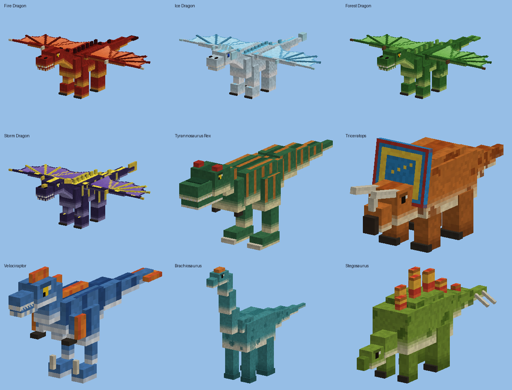
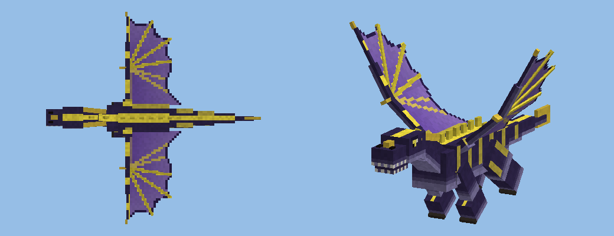
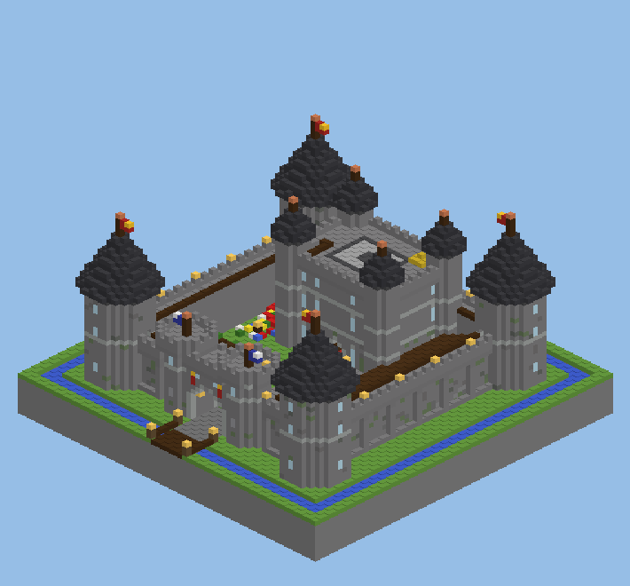
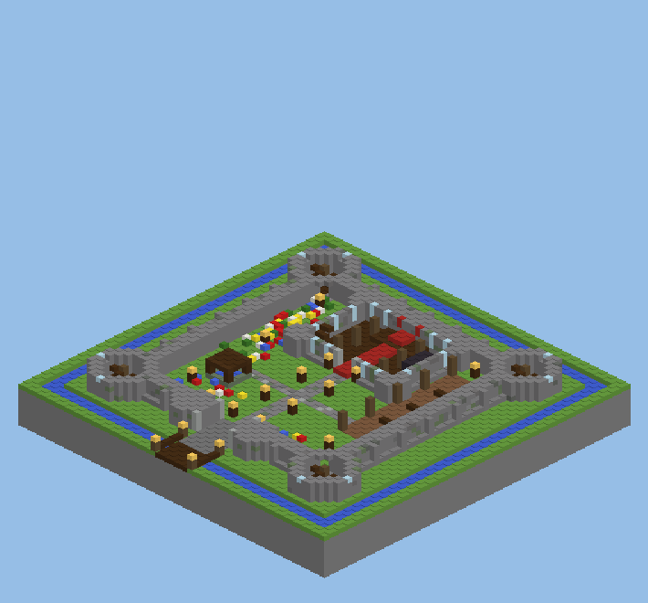

# Dinos & Dragons — Minecraft Bedrock add-on (Android, iOS, Windows, consoles)

Four rideable, flying **dragons** with bat-style wings and five brightly coloured, rideable **dinosaurs**. They roam the
world, and you can tame them. You also get a **castle at the world spawn** that
starts mostly empty so you can decorate it yourself.





## Install on Android

1. Download **[`dist/DinosAndDragons.mcaddon`](dist/DinosAndDragons.mcaddon)** to your phone.
2. Tap the downloaded file in your Downloads / Files app, then pick **Minecraft** to open it.
   Minecraft imports two packs: *Dinos & Dragons* and *Dinos & Dragons Resources*.
3. Create a **new world**. Under **Behavior Packs**, activate **Dinos & Dragons**.
   The resource pack turns on with it.
4. Play. On your first join the castle is built around you (about 2 seconds), and you start in its courtyard.

> If tapping the file does nothing, rename it to `DinosAndDragons.zip` and unzip it.
> Copy `DinosAndDragons_BP` into `games/com.mojang/behavior_packs/` and
> `DinosAndDragons_RP` into `games/com.mojang/resource_packs/`. On newer versions
> that folder is `Android/data/com.mojang.minecraftpe/files/games/com.mojang/`.
> You need Minecraft **1.21.90 or newer**. No experimental toggles are required.

## The creatures

| Creature | Where it lives | Tame it with | Rider ability (Dragon Horn) |
|---|---|---|---|
| 🔥 **Fire Dragon** | badlands, desert, savanna | cooked beef / pork / mutton / chicken, blaze powder | fire breath (sets mobs on fire) |
| ❄️ **Ice Dragon** | snowy & frozen lands | cod, salmon, tropical fish | frost breath (damage and slowness) |
| 🌿 **Forest Dragon** (fastest flyer) | forests, jungles, dark forests | apples, sweet / glow berries, melon | poison spore breath |
| ⚡ **Storm Dragon** (biggest) | mountains, windswept hills | gold ingots, golden carrots, golden apples | lightning breath (big damage and knockback) |
| 🦖 **Tyrannosaurus Rex** | savanna, jungle, plains | raw or cooked meat | earth-shaking roar |
| 🦕 **Brachiosaurus** (3 seats!) | plains, savanna, jungle | apples, melon, berries, oak leaves | roar |
| **Triceratops** | plains, savanna | wheat, apples, carrots, berries, hay | roar and speed boost |
| **Stegosaurus** | forests, taiga, plains | wheat, carrots, potatoes, beetroot | roar and speed boost |
| **Velociraptor** (fast) | forests, jungles, deserts, badlands | raw chicken / rabbit, cod | roar and speed boost |

All of them also have **spawn eggs** in the creative inventory. Wild dinosaurs and
dragons fight back if you hit them. Wild T-rexes, raptors and dragons hunt animals.

## How to play (touch controls)

* **Tame:** hold the creature's favourite food and tap it, again and again, until hearts appear.
* **Ride:** tap a tamed creature. To get off, use the dismount button or sneak.
* **Stay / Follow:** turn on sneak, then tap your creature. It sits and waits (great for keeping
  pets in the castle stable) or gets up and follows you.
* **Fly a dragon:** move forward and the dragon flies the way you are looking. Look up to climb,
  look down to dive, and press **jump** to rise straight up. If you jump off mid-air you get
  slow falling, so you don't splat.
* **Dragon Horn:** every player gets one on first join. While riding, press **Use Horn** to breathe
  fire, frost, spores or lightning (dragons) or to roar (dinosaurs). On foot, it calls all your
  sitting creatures to follow you again.
  Craft more: bone + gold ingot + leather.
* **Heal:** feed a tamed creature its food.
* Tamed meat-eaters and dragons protect you from monsters (not creepers).

## The castle



* **Moat and drawbridge** all the way around, with lantern posts at the bridge.
* **Curtain walls** with a sloped base, buttresses, an overhanging crenellated parapet (corbels
  underneath), a wall-walk with a safety rail, and moss and cracks low on the stone.
* **Four round corner towers**, taller than the walls. Each has a spiral staircase, a room at
  the top, a pointed slate roof and a flag. Doors lead to the courtyard and onto the wall-walk.
* **Gatehouse** between two round guard towers. It has a 7-wide arched gate (room for a T-rex), a
  raised portcullis, red banners, overhanging battlements and a guard room on the wall-walk.
* **Keep** with four corner turrets with spires and stone bands around it. Inside: a great hall
  with pillars, a fireplace, chandeliers and a dais for your throne, plus two empty upper floors.
  On the roof there is a dragon landing pad and a hay nest.
* **Lean-to dinosaur stable** along the east wall, tall enough for a brachiosaurus. Also a roofed
  well, a flower garden, and mixed cobblestone paths.
* The rooms are left bare on purpose so you can decorate. Everything is lit, so monsters won't spawn inside.

The world spawn is set in the courtyard, just inside the gate.



**Existing worlds:** the castle is only built on its own in a brand-new world. In an
older world you get a **Castle Blueprint** instead. Stand where you want the castle,
then **sneak and use** the blueprint. Careful: it clears a 67×67 area around you.
Craft more blueprints from 8 stone bricks around 1 paper.

**Commands** (needs cheats):

| Command | What it does |
|---|---|
| `/scriptevent dd:castle` | Build a castle centred on you |
| `/function dd/castle/build_here` | Same thing using only functions |
| `/scriptevent dd:spawn_all` | Spawn one of every creature around you |
| `/scriptevent dd:setspawn` | Move the world spawn to where you stand |
| `/scriptevent dd:help` | Show the creature guide again |

## For modders: rebuilding the add-on

Everything in `packs/` and `dist/` is generated. You can change the models, colours,
stats, spawn biomes or castle and rebuild:

```bash
pip install pillow numpy
python3 tools/build.py      # writes packs/, dist/DinosAndDragons.mcaddon, docs/previews/
python3 tools/validate.py   # cross-checks the generated packs
```

| File | What's in it |
|---|---|
| `tools/creatures.py` | Each creature's 3D model (boxes, colours, patterns) and its stats, foods, biomes and sounds |
| `tools/geo.py` | Box-UV texture packer and painter, geometry writer, preview renderer |
| `tools/castle.py` | The castle: every wall, tower and room as `/fill` commands |
| `tools/build.py` | Writes entities, spawn rules, animations, items, particles and manifests |
| `src/main.js` | Gameplay script (`@minecraft/server` 2.0.0): castle at spawn, horn abilities, rider safety |
